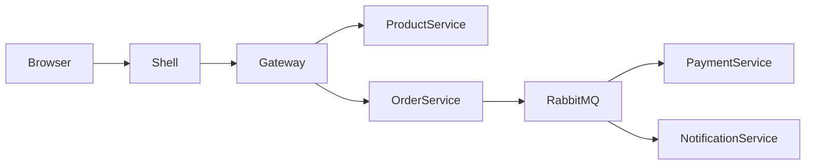

# Architecture Overview

## Why microfrontends?

Microfrontends let us split UI ownership by business capability. The shell host owns navigation and composition while the product and cart MFEs own their own UI and can evolve independently.

## Why microservices?

Microservices allow the platform to separate concerns such as auth, product, cart, and order handling. This makes the architecture easier to reason about and mirrors how larger enterprises organize teams.

## Why an API gateway?

The gateway is the front door for clients. It centralizes routing, auth verification, rate limiting, and request normalization.

## Why database per service?

Each service owns its own data. That reduces coupling and makes it easier to change one service without impacting another.

## Why RabbitMQ?

RabbitMQ provides async messaging for workflows such as order-created and payment-completed events. It decouples services and allows the platform to demonstrate eventual consistency.

## Why Redis?

Redis provides caching and temporary shared state. In this prototype it is used for product catalog caching and rate-limiting examples.

## Request flow

